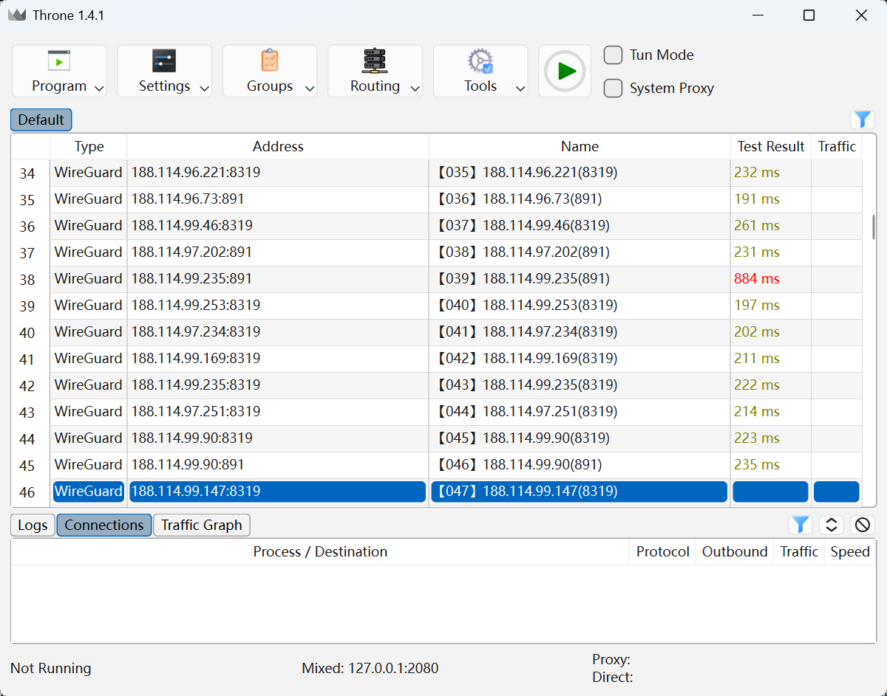
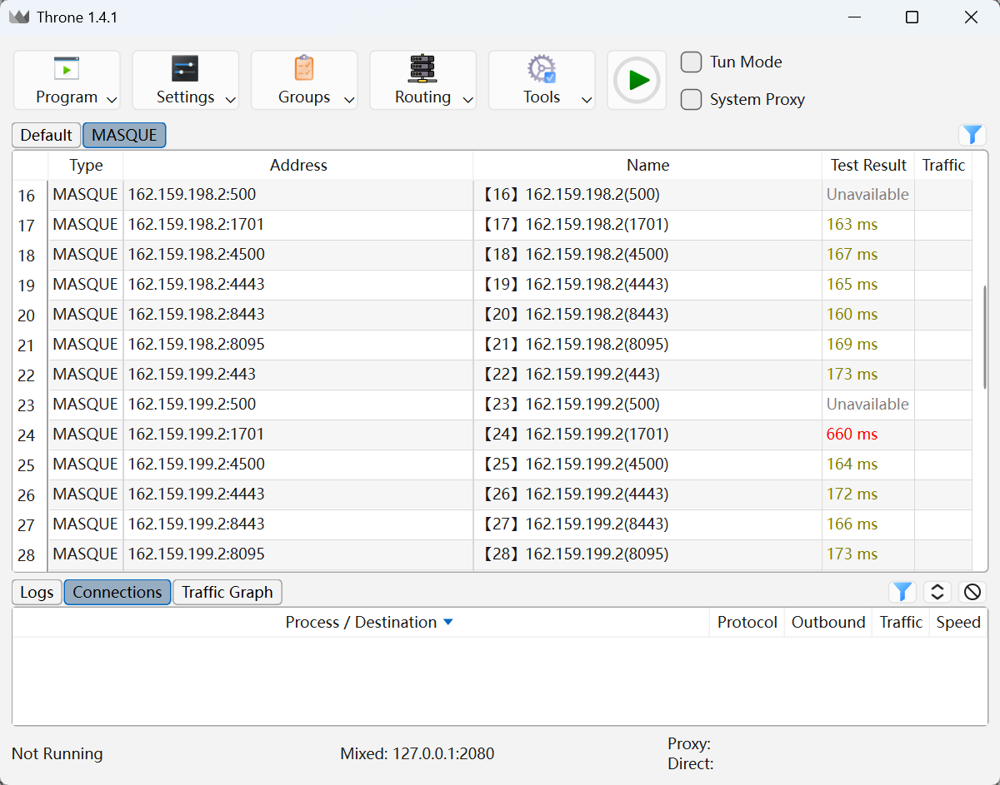

# cfwarp-converter

cfwarp转换工具集，将 Cloudflare WARP 官方的 WireGuard（AmneziaWG ） 和 Masque 协议接口转换到第三方代理软件中使用。

一对一转换的部分代码在分支：https://github.com/juerson/cfwarp-converter/tree/sing

### 一、支持

1、sing-box内核代表

+ [Throne for PC](https://github.com/throneproj/Throne)（支持 AmneziaWG 和 Masque 协议）
+ [Throne for Android](https://github.com/throneproj/ThroneForAndroid) （支持 AmneziaWG 和 Masque 协议）
+ [NekoBox for Android](https://github.com/MatsuriDayo/NekoBoxForAndroid)（暂不支持 AmneziaWG 和 Masque 协议）
+ [NyameBox / NekoBox for PC](https://github.com/qr243vbi/nekobox)（导入程序测试，发现很多不可用，不推荐使用它）
+ [nekoray / NekoBox For PC（早期版本）](https://github.com/MatsuriDayo/nekoray)（停止更新了，不推荐使用它）
+ [sing-box](https://github.com/SagerNet/sing-box) 内核裸跑，运行命令：**sing-box run -c config.json** （暂不支持 AmneziaWG 和 Masque 协议）
+  [sing-box-lx](https://github.com/Leadaxe/sing-box-lx) 内核裸跑，运行命令：**sing-box run -c config.json**（支持 AmneziaWG 和 Masque 协议）
+ ……

2、xray内核代表

+ [v2rayN](https://github.com/2dust/v2rayN)（暂不支持 AmneziaWG 和 Masque 协议）
+ [v2rayNG](https://github.com/2dust/v2rayNG)（导入失败，可能软件版本问题）
+ ……

3、mihomo（clash.meta）内核代表

+ [Clash Party](https://github.com/mihomo-party-org/clash-party)
+ [Clash Verge rev](https://github.com/clash-verge-rev/clash-verge-rev)
+ [Clash Meta for Android](https://github.com/MetaCubeX/ClashMetaForAndroid)
+ [FlClash](https://github.com/chen08209/FlClash)
+ [Clash Mi](https://github.com/KaringX/clashmi)
+ [Pandora-Box](https://github.com/snakem982/Pandora-Box)
+ [mihomo](https://github.com/MetaCubeX/mihomo) 内核裸跑，运行命令：**mihomo.exe -f config.yaml -d .**
+ 上面列举的，如果使用最新版本的，其内核mihomo都会更新，理论上都支持 AmneziaWG 和 Masque 协议
+ ……

温馨提示：

1、如果你使用的代理软件，不在上面所列范围，也可能能使用，取决要执行的内核是否支持WireGuard或Masque，是否要节点转换(订阅转换)，自己动脑判断/处理。

2、WireGuard 协议的升级 AmneziaWG 协议，加入了垃圾数据包进行混淆，提高抗DPI识别能力，连接使用成功率很高，目前发现只有几个失败的，使用 WireGuard 协议的，推荐添加CLI命令 `--amnezia` 参数转换为 AmneziaWG 协议使用，或者网页端操作获取订阅URL。

3、目前发现最新 [sing-box-lx](https://github.com/Leadaxe/sing-box-lx) 内核、[mihomo](https://github.com/MetaCubeX/mihomo) 内核、Throne 客户端（PC/Android）都支持 AmneziaWG、MASQUE。

4、目前不支持转换为纯json配置的xray。

5、需要使用其他工具优选IP地址，替换文件 `ip.txt` 和 `result.csv` 的数据使用，注意，转换时，默认选择 `result.csv` 文件，可选`ip.txt` 文件，不要选错文件选错优选IP，导致写错**端点**地址到节点，最后测试发现连接都失效。

6、如果发现测试延迟都失败，可以考虑更换测试延迟的URL，例如：https://www.gstatic.com/generate_204、https://cp.cloudflare.com/generate_204、https://www.google.com/generate_204

7、裸核跑代理的，可以在浏览器中打开对应的控制面板切换节点

- sing-box(-lx)

  （1）访问本地版 http://127.0.0.1:9091 或者访问官网 https://sing-box-dashboard.sagernet.org/
  填URL： http://127.0.0.1:9091
  （2）访问本地版 http://127.0.0.1:9090 或者访问官网 https://metacubex.github.io/metacubexd/ 
  填后端地址：http://127.0.0.1:9090

  正式使用代理，要在操作系统的网络中，填代理地址：127.0.0.1:2080

- mihomo

  （1）访问本地版 http://127.0.0.1:9093/ui/ 点 metacubexd 或者访问官网 https://metacubex.github.io/metacubexd/ 
  填后端地址：http://127.0.0.1:9093

  正式使用代理，要在操作系统的网络中，填代理地址：127.0.0.1:10801

8、配置文件中，`sing-box.json` 和 `clash.yaml` 模板已经配置，可以拿去其它地方套用，几乎解决了DNS泄漏问题，目前测试几次，通过网上的DNS泄漏查询网站检查，没有发现DNS泄漏问题。用到这个warp上，会定位到自家的IP信息，没办法解决，以前可以通过两个不同的私钥，链式代理解决IP定位到自家问题(warponwarp)，现在不行了，wireguard on wireguard，还是 masque on masque，还是 wireguard 与 masque 的组合都会定位到自己的IP信息，强行链式代理反而会影响网速。

### 二、使用

以Windows为例，执行下面命令，其它系统自己探索。

```cmd
# 检查本机是否安装python，没有就安装，不懂就问AI怎么安装python
python --version
python3 --version

# 创建虚拟环境，项目依赖隔离
python -m venv venv

# 激活虚拟环境
venv\Scripts\activate
.\venv\Scripts\Activate.ps1 # 使用 PowerShell

# 升级 pip，避免安装依赖时，提示要升级 pip
python -m pip install --upgrade pip

# 安装依赖
pip install -r requirements.txt
pip install -r requirements.txt -i https://pypi.tuna.tsinghua.edu.cn/simple # 如果下载速度较慢，可以使用国内镜像源

# (可选)注册(执行一次即可，更换成自己唯一的 WireGuard、MASQUE 私钥才执行，避免滥用)
python register.py
# (可选)CLI命令 -- 查看帮助
python main.py -h
# (可选)开启本地http服务，网页上可以选客户端操作，获取订阅URL
python main.py server
# (可选)开启本地http服务，并提供给局域网其它设备订阅（跨设备使用）
python main.py server --host 0.0.0.0
```

前面执行一遍，下次再使用，就执行：

```cmd
# 激活虚拟环境(上次执行命令，已经将依赖安装好)
venv\Scripts\activate

# (可选)注册(执行一次即可，更换成自己唯一的 WireGuard、MASQUE 私钥才执行，避免滥用)
python register.py
# (可选)CLI命令 -- 查看帮助
python main.py -h
...
```

注意：注册wg和masque账号的，请勿滥用，不要使劲薅。

### 三、截图






.png)


### 四、忠告

非官方承认的工具，非法接入，大量并发连接，可能导致短/长时间所有都不能连接 Cloudflare WARP 服务器使用，或者本地网络提供商发现异常阻断，敏感期网络提供商阻断IP段，也有可能，**能否使用看你当地网络情况。**

