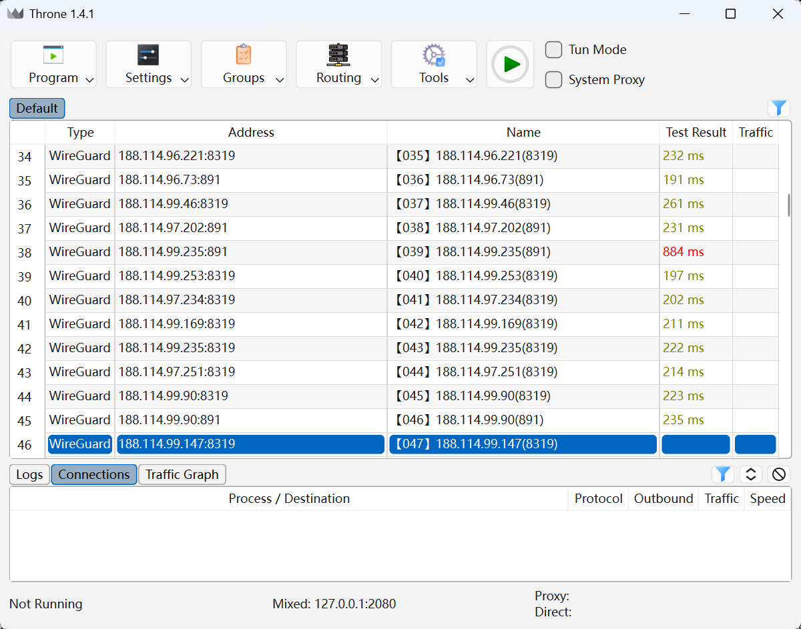
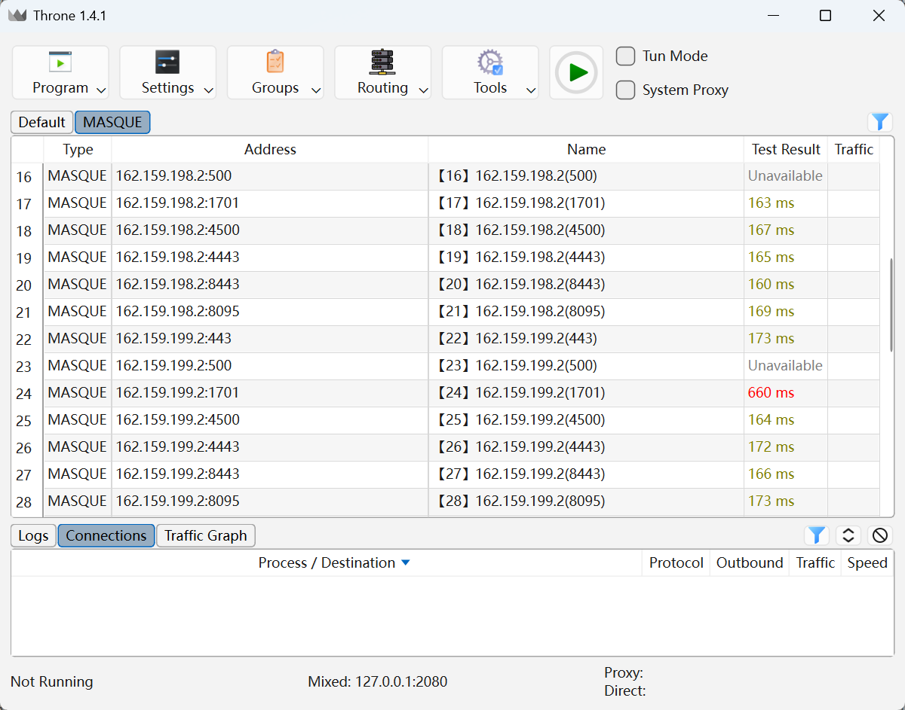
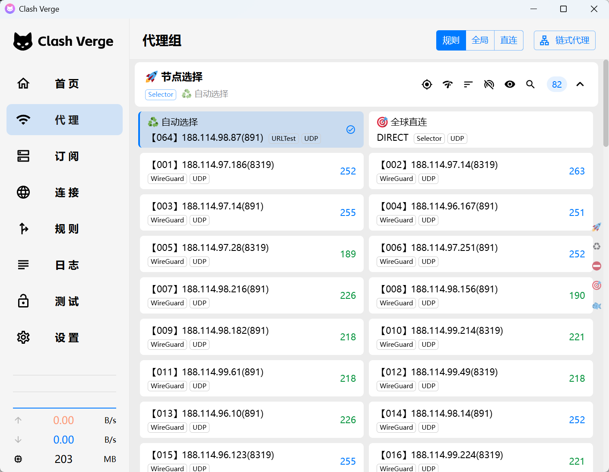
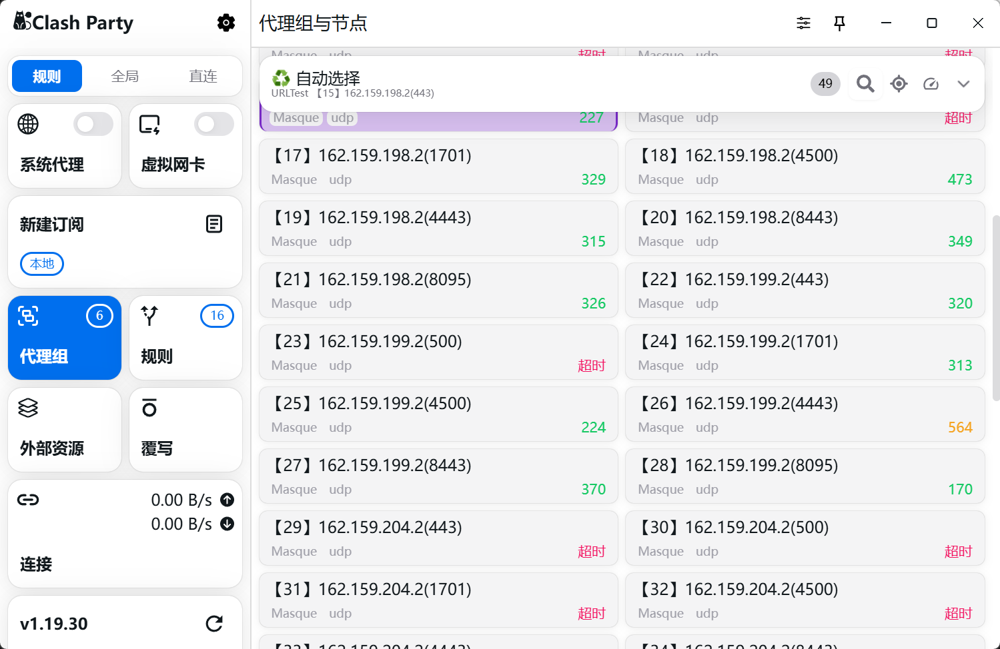

# cfwarp-converter

cfwarp转换工具集，将 Cloudflare WARP 官方的 WireGuard（AmneziaWG ） 和 Masque 协议接口转换到第三方代理软件中使用。

一对一转换的部分代码在分支：https://github.com/juerson/cfwarp-converter/tree/sing

### 一、支持

| 客户端 / 内核 | WireGuard | MASQUE | AWG (AmneziaWG)[^3] | 前三列任意支持项 + OpenVPN |
| --- | :---: | :---: | :---: | :---: |
| Throne for PC / Android | ✅ | ✅ | ✅ | ❌ |
| NekoBox by qr243vbi[^1] | ✅ | ❌ | ✅ | ❌ |
| NekoBox For PC[^2] / Android     |     ✅     | ❌ | ❌ | ❌ |
| v2rayN / v2rayNG | ✅ | ❌ | ❌ | ❌ |
| Hiddify[^new] for PC / Android | ✅ | ✅ | ✅ | ❌[^7] |
| sing-box 内核[^4] | ✅ | ❌ | ❌ | ✅ |
| sing-box-lx 内核 | ✅ | ✅ | ✅ | ✅ |
| mihomo 内核[^5] | ✅ | ✅ | ✅ | ✅ |
| clash-rs 内核[^6] | ✅ | ❌ | ❌ | ❌ |

[^1]: v5.11.28.3
[^2]: v4.0.1-v4.2.7 老版本
[^3]: 基于 WireGuard 协议而升级，详情：https://github.com/amnezia-vpn/amneziawg-go
[^4]: 包括桌面端 SFW 和安卓端 SFA
[^5]: 包括对应的桌面端和移动端，比如：Clash Verge rev、Clash Party、FlClash 等
[^6]: 包括桌面端 clash-nyanpasu 里面有一个 clash-rs 内核可切换使用
[^7]: 没有用到 OpenVPN
[^new]: 新版支持

##### 1、sing-box 内核代表

+ [Throne for PC](https://github.com/throneproj/Throne)（支持 AmneziaWG 和 Masque 协议）
+ [Throne for Android](https://github.com/throneproj/ThroneForAndroid) （支持 AmneziaWG 和 Masque 协议）
+ [NekoBox for Android](https://github.com/MatsuriDayo/NekoBoxForAndroid)（暂不支持 AmneziaWG 和 Masque 协议）
+ [NekoBox by qr243vbi](https://github.com/qr243vbi/nekobox/releases/tag/5.11.28.3)（支持 AmneziaWG）
+ [NekoBox by MatsuriDayo（原作者版本）](https://github.com/MatsuriDayo/nekoray) 和接力者 [throneproj](https://github.com/throneproj/Throne/releases/tag/4.2.7) v4.2.7之前的低版本（不推荐使用它）
+ [Hiddify app](https://github.com/hiddify/hiddify-app) （支持 AmneziaWG 和 Masque 协议）
+ [sing-box](https://github.com/SagerNet/sing-box) SFW桌面程序或内核裸跑，运行命令：**sing-box run -c config.json** （暂不支持 AmneziaWG 和 Masque 协议）
+ [sing-box-lx](https://github.com/Leadaxe/sing-box-lx) 内核裸跑，运行命令：**sing-box run -c config.json**（支持 AmneziaWG 和 Masque 协议）
+ ……

##### 2、xray 内核代表

+ [v2rayN](https://github.com/2dust/v2rayN)（暂不支持 AmneziaWG 和 Masque 协议）
+ [v2rayNG](https://github.com/2dust/v2rayNG)（暂不支持 AmneziaWG 和 Masque 协议）
+ ……

##### 3、mihomo 内核代表

+ [Clash Party](https://github.com/mihomo-party-org/clash-party)
+ [Clash Verge rev](https://github.com/clash-verge-rev/clash-verge-rev)
+ [Clash Meta for Android](https://github.com/MetaCubeX/ClashMetaForAndroid)
+ [FlClash](https://github.com/chen08209/FlClash)
+ [Clash Mi](https://github.com/KaringX/clashmi)
+ [Pandora-Box](https://github.com/snakem982/Pandora-Box)
+ [Chimera](https://github.com/MFSGA/Chimera)
+ [mihomo](https://github.com/MetaCubeX/mihomo) 内核裸跑，运行命令：**mihomo.exe -f config.yaml -d .**
+ 上面列举的，如果使用最新版本的，其内核mihomo都会更新，理论上都支持 AmneziaWG 和 Masque 协议
+ ……

##### 4、clash-rs 内核代表

+ [clash-rs](https://github.com/ibigbug/clash-rs) 内核裸跑，运行命令：**clash-rs.exe -f config.yaml -d .**
+ [clash-nyanpasu](https://github.com/LibNyanpasu/clash-nyanpasu) 客户端，切换 clash-rs 内核跑


#### 温馨提示：

- 1、如果你使用的代理软件，不在上面所列范围，也可能能使用，取决要执行的内核是否支持WireGuard、Masque、AmneziaWG、OpenVPN，是否要节点转换(代理软件内置节点转换，是否丢失字段，转换失败)，自己动脑判断/处理。

- 2、WireGuard 协议的升级 AmneziaWG 协议，加入了垃圾数据包进行混淆，提高抗DPI识别能力，连接使用成功率很高，目前发现只有几个失败的，使用 WireGuard 协议的，推荐添加CLI命令 `--amnezia` 参数转换为 AmneziaWG 协议使用，或者网页端操作获取订阅URL。

- 3、支持 OpenVPN 通过 WireGuard 拨号进行链式代理（有的直连被墙，无法连通），获取免费的日本家宽IP地址，节点有的不可用有的速度慢，只能用刀刃上，节点可能失效，还要不定时更新一下订阅（重新拉取订阅内容）。**OpenVPN 来源：**[Link](https://www.vpngate.net/cn/)

- 4、数据源`ip.txt` 和 `result.csv` ，需借助其它工具优选。注意，转换时，**不要用错 txt/csv 数据(具体还看你替换的数据)**，避免用错导致测试延迟、连接都失效。

- 5、使用过程，如果发现测试延迟都失败，可以考虑更换测试延迟的URL，例如：

  ```txt
  https://cp.cloudflare.com/generate_204
  https://www.gstatic.com/generate_204
  https://www.google.com/generate_204
  ```

- 6、裸核跑代理的，可以在浏览器中打开对应的控制面板切换节点

  **sing-box(-lx) 裸核**

  （1）访问本地版 http://127.0.0.1:9091 或者访问官网 https://sing-box-dashboard.sagernet.org/
  填URL： http://127.0.0.1:9091

  （2）访问本地版 http://127.0.0.1:9090 或者访问官网 https://metacubex.github.io/metacubexd/ 
  填后端地址：http://127.0.0.1:9090

  正式使用代理，要在操作系统的网络中，填代理地址：127.0.0.1:2080

  **mihomo / clash-rs 裸核**

  （1）访问本地版 http://127.0.0.1:9093/ui/ 点 metacubexd 或者访问官网 https://metacubex.github.io/metacubexd/ 
  填后端地址：http://127.0.0.1:9093

  正式使用代理，要在操作系统的网络中，填代理地址：127.0.0.1:10801

  注意：**clash-rs** API服务需要secret密码，自己在配置文件中修改，或转换前在`配置文件\clash-rs.yaml`中修改 `secret: "clashrs-9093"`。


### 二、使用

以Windows为例，执行下面命令，其它系统自己探索。

```cmd
# 检查本机是否安装python，没有就安装，不懂就问AI怎么安装python
python --version
python3 --version

# 创建虚拟环境，项目依赖隔离
python -m venv venv

# 激活虚拟环境
venv\Scripts\activate
.\venv\Scripts\Activate.ps1 # 使用 PowerShell

# 升级 pip，避免安装依赖时，提示要升级 pip
python -m pip install --upgrade pip

# 安装依赖
pip install -r requirements.txt
pip install -r requirements.txt -i https://pypi.tuna.tsinghua.edu.cn/simple # 如果下载速度较慢，可以使用国内镜像源

# (可选)注册(执行一次即可，更换成自己唯一的 WireGuard、MASQUE 私钥才执行，避免滥用)
python register.py
# (可选)CLI命令 -- 查看帮助
python main.py -h
# (可选)开启本地http服务，网页上可以选客户端操作，获取订阅URL
python main.py server
# (可选)开启本地http服务，并提供给局域网其它设备订阅（跨设备使用）
python main.py server --host 0.0.0.0
```

前面执行一遍，下次再使用，就执行：

```cmd
# 激活虚拟环境(上次执行命令，已经将依赖安装好)
venv\Scripts\activate

# (可选)注册(执行一次即可，更换成自己唯一的 WireGuard、MASQUE 私钥才执行，避免滥用)
python register.py
# (可选)CLI命令 -- 查看帮助
python main.py -h
...
```

注意：注册wg和masque账号的，请勿滥用，不要使劲薅。

### 三、截图





.png)





更多截图见：[images](images/) 目录。

### 四、忠告

非官方承认的工具，非法接入，大量并发连接，可能导致短/长时间所有都不能连接 Cloudflare WARP 服务器使用，或者本地网络提供商发现异常阻断，敏感期网络提供商阻断IP段，也有可能，**能否使用看你当地网络情况。**

